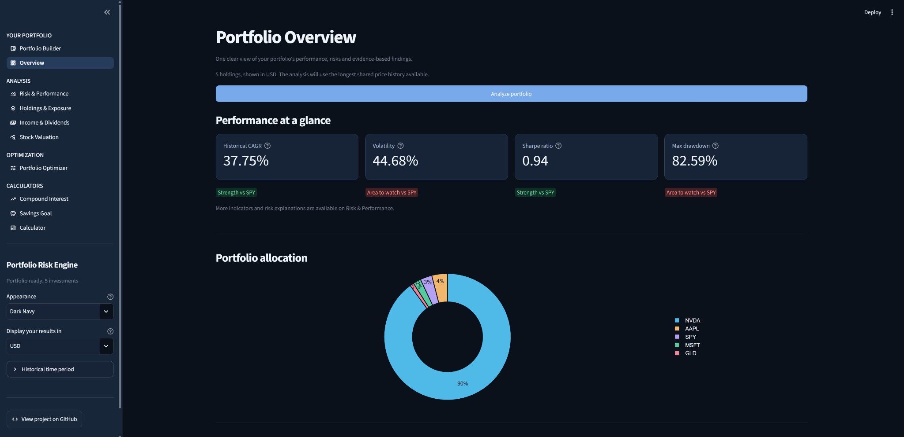
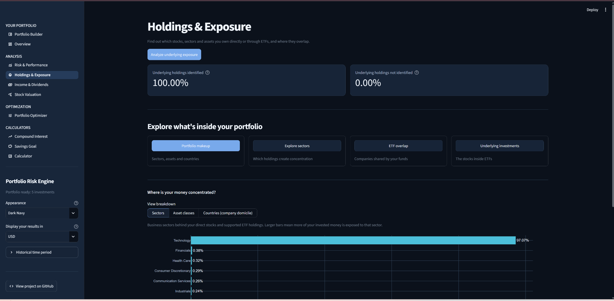
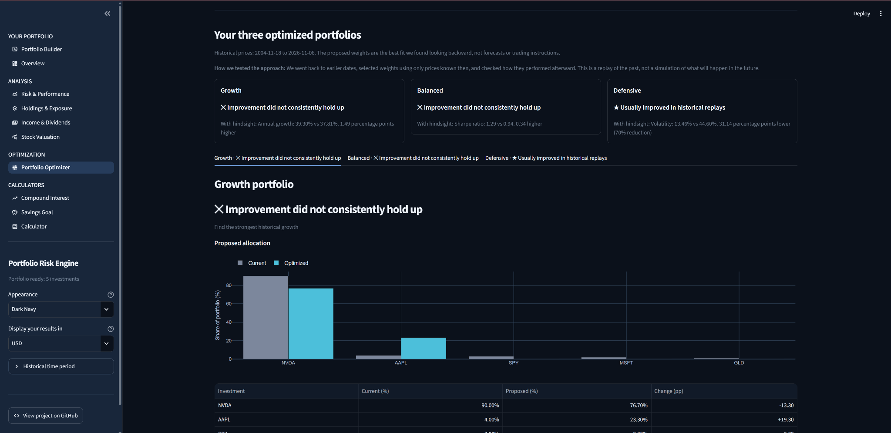
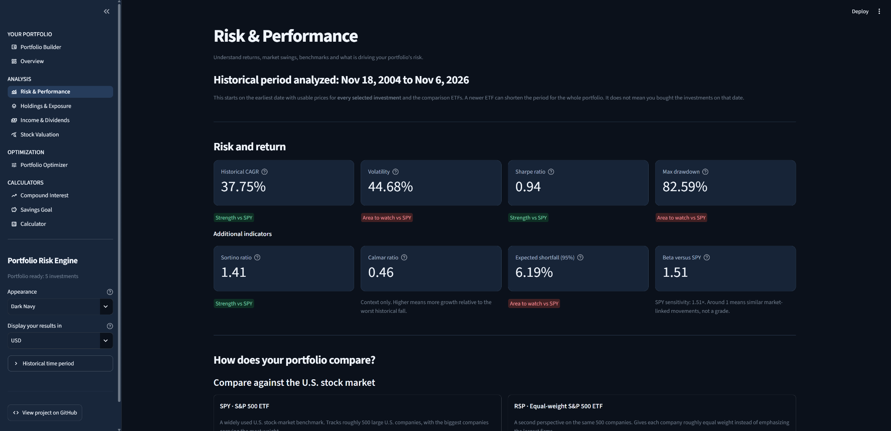
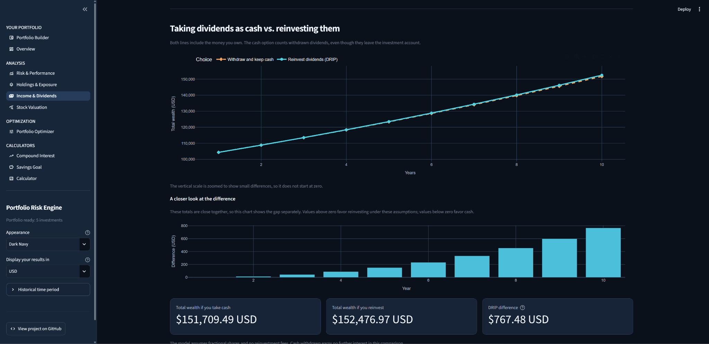
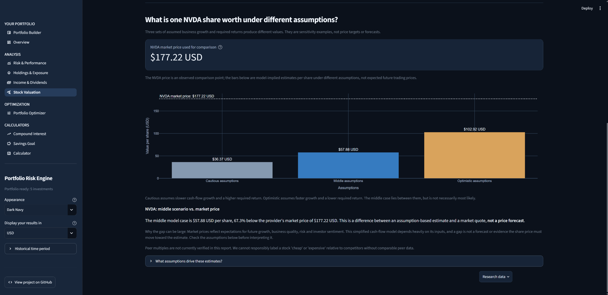

# Portfolio Risk Engine

**An interactive portfolio analytics and optimization dashboard built with Python and Streamlit.**

Portfolio Risk Engine helps investors explore what they own, understand historical risk and returns, compare their results with market benchmarks, and test alternative portfolio allocations. It combines a straightforward dashboard with a modular, independently testable financial analysis backend.

**Python 3.10+** · **Streamlit** · **Pandas / NumPy / SciPy** · **Plotly** · **CAD and USD support**

> [!IMPORTANT]
> **Educational research tool, not investment advice.** Historical performance, optimized weights, valuation scenarios, and hypothetical projections are not forecasts or recommendations. No trades are placed.

## What you can do

| Page | Capabilities |
| --- | --- |
| **Portfolio Builder** | Find investments by ticker or company name, enter holding values or target weights, import/export CSVs, choose CAD or USD, and load sample portfolios. Supports up to 40 holdings. |
| **Overview** | Review your portfolio's historical performance, allocation, key risk measures, benchmark comparisons, and evidence-based findings. |
| **Risk & Performance** | Explore annualized growth, volatility, Sharpe and Sortino ratios, drawdowns, expected shortfall, market sensitivity, and comparisons with SPY and RSP. |
| **Holdings & Exposure** | Examine sector and asset-class exposure, company geography, ETF overlap, and the underlying holdings of supported funds. |
| **Income & Dividends** | Estimate dividend/distribution income and explore cash withdrawals versus dividend reinvestment (DRIP) under adjustable assumptions. |
| **Stock Valuation** | Inspect P/E, price-to-free-cash-flow and EV/EBITDA metrics, plus cautious, middle, and optimistic cash-flow valuation scenarios for supported companies. |
| **Portfolio Optimizer** | Compare portfolios optimized for **Growth**, **Balanced** (risk-adjusted return), and **Defensive** (lower volatility), including historical replay tests and benchmark comparisons. |

The sidebar also includes three standalone tools: **Compound Interest**, **Savings Goal**, and a **Calculator**.

### Built for exploration

- **Flexible portfolio entry:** Search for securities, enter investment amounts or percentages, and work in either CAD or USD.
- **Understandable comparisons:** Compare portfolio metrics against SPY (capitalization-weighted S&P 500) and RSP (equal-weight S&P 500) on aligned historical dates.
- **Explainable results:** See positive, negative, or similar outcomes alongside the relevant figures and a brief interpretation.
- **Historical optimization checks:** See what performed best with the full historical record, then separately evaluate how a method held up when allocations were selected using earlier data and tested on subsequent periods.
- **Realistic simulation choices:** Explore buy-and-hold versus periodic rebalancing, trading-cost assumptions, optional allocation limits, and your own proposed weights.
- **Data-quality transparency:** Unsupported or unidentified fund holdings are distinguished from verified exposures rather than silently filled in.
- **Multiple dark themes:** Dark Navy, Ocean Blue, Forest Green, and Burgundy Red, with coordinated charts and controls.

## Screenshots

Screenshots show **hypothetical example portfolios** in the Dark Navy theme. Figures and available market data may change between runs.

### Portfolio overview

Historical return and risk metrics, portfolio allocation, and benchmark-relative status in one place.



### Holdings and exposure

A breakdown of the sectors and underlying holdings driving portfolio concentration.



### Portfolio optimizer

Explore Growth, Balanced, and Defensive allocations with explicit historical validation results and comparisons to the current portfolio.



<details>
<summary><strong>More screenshots: Risk & Performance, Income & Dividends, and Stock Valuation</strong></summary>

### Risk and performance

Review portfolio growth, volatility, drawdown, and risk-adjusted returns alongside SPY and RSP.



### Income and dividends

Compare hypothetical cash withdrawals with dividend reinvestment, including a closer view of the resulting difference.



### Stock valuation

Review assumption-driven cash-flow valuation scenarios against an observed market-price reference.



</details>

## Quick start

### Requirements

- Python **3.10 or newer**
- An internet connection for live market data and supported ETF/company information
- No brokerage account or paid market-data subscription required for the core application

### Install and run (Windows PowerShell)

```powershell
cd "C:\path\to\PortfolioRiskEngine"

python -m venv .venv
.\.venv\Scripts\Activate.ps1

python -m pip install --upgrade pip
python -m pip install -e ".[dev]"
python -m pip install -r requirements-v9.txt

python -m streamlit run streamlit_app.py
```

Streamlit will show the local URL for the dashboard, usually `http://localhost:8501`.

Replace the example `cd` path with the folder where you cloned the repository. The `requirements-v9.txt` filename is retained from the dashboard development phase; it contains the Streamlit/Plotly UI requirements.

### First use

1. Open **Portfolio Builder** and enter your investments, or load a ready-made portfolio under **Sample portfolios for testing**.
2. Select your reporting currency in the sidebar.
3. Explore **Overview**, **Risk & Performance**, and **Holdings & Exposure**.
4. Open **Portfolio Optimizer** to compare Growth, Balanced, and Defensive allocations with your original portfolio and market benchmarks.

Sample portfolios are hypothetical test cases. They do not represent investment recommendations.

## How the optimizer works

The optimizer reallocates **only among securities already included in the portfolio**. It evaluates three different historical objectives:

| Objective | Historical quantity being optimized |
| --- | --- |
| **Growth** | Maximize compounded annual growth |
| **Balanced** | Maximize the Sharpe ratio, a measure of return relative to total volatility |
| **Defensive** | Minimize portfolio volatility |

For each objective, the dashboard shows proposed weights, changes from the starting allocation, risk and performance metrics, and comparisons with SPY and RSP. Weight caps and rebalancing settings can be adjusted where supported.

**Hindsight is not validation.** An allocation selected using the entire price history can look impressive simply because it benefits from information that was not available earlier. The dashboard therefore also replays past decisions: it selects weights from earlier data and evaluates the resulting approach on later historical periods. These tests can support or challenge the method, but cannot prove future outperformance.

## Data and methodology

- **Market prices and company information:** Best-effort retrieval via Yahoo Finance / `yfinance`, subject to provider availability and data quality.
- **Fund holdings:** Optional holdings and exposure information from supported sources, including [TickerInside](https://tickerinside.com/) where applicable. TickerInside data attribution: [CC BY 4.0](https://creativecommons.org/licenses/by/4.0/).
- **Reporting currency:** CAD and USD conversions with dated FX observations where required.
- **Historical comparability:** Portfolio and benchmark results use shared available price dates. Adding a recently launched ETF can shorten the usable history.
- **Portfolio history:** A backtest applies an entered allocation retrospectively. It does not reconstruct a user's actual purchase dates or transaction history.
- **Returns and costs:** Historical simulations use price/adjusted-price proxies and explicit rebalancing assumptions. Trading costs can be modeled in supported scenarios, but spreads, slippage, taxes, and market impact are not fully represented.
- **Data gaps:** ETF look-through and company fundamentals can be incomplete or unavailable. The application reports coverage limitations instead of assuming missing data are zero.
- **Valuation and dividends:** Cash-flow valuations and future dividend scenarios depend on simplified assumptions. They are not price targets or guaranteed payments.

Historical ticker selection introduces survivorship and selection bias. Past statistical relationships, including correlations and volatility, may change substantially. This project does not provide live trading, brokerage integration, or personalized financial advice.

## Project structure

```text
PortfolioRiskEngine/
├── streamlit_app.py           # Streamlit application entry point
├── portfolio_risk_ui/         # Dashboard pages, charts, presentation and calculators
├── src/portfolio_risk/        # Financial calculations, data adapters and CLI
├── tests/                     # Backend and numerical regression tests
├── tests_v9/                  # Dashboard, optimizer and presentation tests
├── examples/                  # Synthetic portfolios and research fixtures
├── docs/                      # Technical notes and development documentation
├── .streamlit/                # Streamlit configuration
├── pyproject.toml             # Python package and development dependencies
├── requirements-v9.txt        # Dashboard dependencies
├── .env.example               # Optional environment variable template
└── .gitignore
```

The financial analytics backend is separate from the Streamlit interface. This allows calculation logic and data validation to be tested without launching the dashboard.

## Tests

From the project folder:

```powershell
python -m pytest -o addopts="" -q
```

The test suites cover portfolio calculations, input validation, historical simulations, optimizer behavior, presentation logic, and UI regression cases. Most tests are designed to run without live API requests. A passing offline test suite does not independently certify live provider data.

For historical development details and the underlying research commands, see [`docs/`](docs/).

## Privacy

The app is intended for exploratory, locally entered portfolios. **Do not commit real personal holdings, account statements, API keys, credentials, or downloaded private reports.** The repository's `.gitignore` excludes common secret files, caches, and private portfolio filenames. Review any additional files before publishing.
